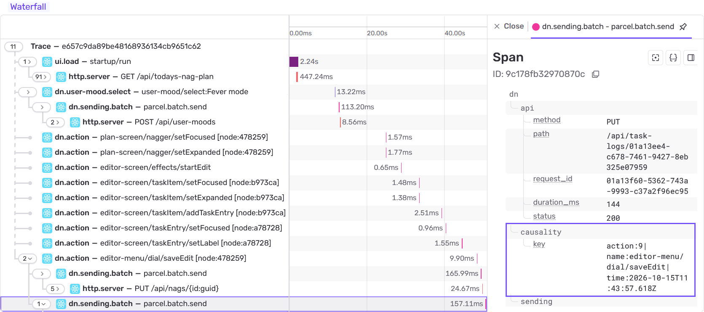
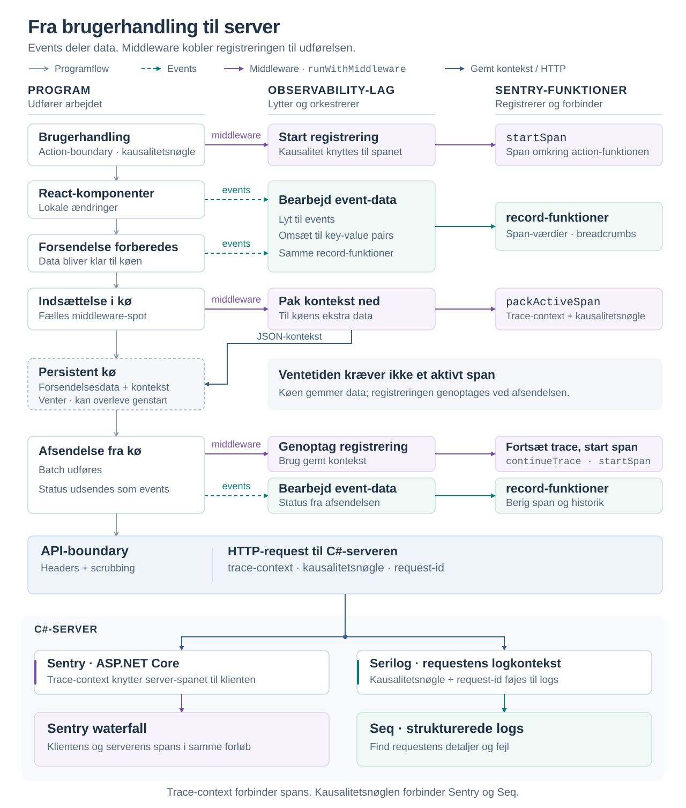

## Case 3: Kausal observability fra brugerhandling til server med low coupling

### Resultat

Løsningen giver kausal end-to-end observability: En brugerhandling kan via en
kausalitetsnøgle følges gennem den persistente afsendelseskø til serverens behandling,
også når afsendelsen sker senere eller efter en genstart af appen.

Events og simple middleware-spots gør det muligt at registrere forløbet uden at
blande observability ind i komponenternes og services’ arbejde. Det bevarer low
coupling mellem lagene og styrker cohesion ved at samle registreringen i
observability-laget.

En fælles API-boundary sikrer, at trace-context medsendes til serveren ét sted frem
for i hvert API-kald. Den giver samtidig ét centralt sted at scrubbe
observability-oplysninger.

### Problemstilling

DailyNagger organiserer opgaver i redigerbare datatræer. Brugeren skal kunne registrere
arbejde ved dårlig forbindelse og fortsætte på flere enheder. En handling kan derfor
ændre træet lokalt, blive sendt senere og møde ændringer fra en anden enhed. Hvis
resultatet bliver forkert, kan årsagen ligge i flere led, der er adskilt både i kode og
tid.

### Krav

For at kunne finde *root cause* skal det være muligt at følge en detaljeret historie om
forløbet: Hvad satte det i gang, hvilke events fulgte, og hvordan endte det?

Registreringen af den historie må ikke gå ud over kodekvaliteten eller bryde
*separation of concerns*.

### Første løsning: Record-funktioner

Sentry blev valgt for kompatibiliteten med Expo/React Native og .NET samt muligheden
for at vise forløbet som en waterfall af spans.

Den første løsning samlede Sentry-kald i et observability-bibliotek. Record-funktioner
modtog statusoplysninger og føjede dem til det aktive Sentry-span. React-komponenterne
kunne derfor nøjes med at importere og kalde den relevante record-funktion dér, hvor
noget skete—i teorien én linje pr. event.

DailyNaggers afsendelseskø udsætter ændringer med debounce (se case 2), så det
oprindelige span kan være afsluttet ved afsendelsen. Record-funktionerne skulle
derfor både kunne skrive til det aktive span, pakke span-konteksten ned til køen og
udpakke den for at fortsætte sporet senere.

Det viste sig også, at meget af dataen fra React-komponenterne krævede bearbejdning,
før den kunne registreres. Det førte til flere specialbyggede record-funktioner til
de enkelte komponenter.

### Et ekstra abstraktionslag

Der var derfor brug for et abstraktionslag, som kunne modtage og bearbejde
komponenternes data og orkestrere simple record-funktioner. Hverken komponenterne
eller record-funktionerne måtte kende laget. Det skulle være muligt at udvide
registreringen eller udskifte Sentry uden at ændre komponenterne.

### Event emitters

Afsendelseskøen havde allerede en event emitter, som udsendte events, når
forbindelsen blev afbrudt eller køens indhold ændrede sig. Brugerfladen lyttede til
events for at vise beskeder og animere, hvordan ændringer ventede i køen eller
blev slået sammen.

Emitteren blev gjort genbrugelig, så andre komponenter kunne udsende events med
data uden at kende modtagerne. Abstraktionslaget kunne nu lytte til de samme
events, bearbejde dataene og kalde record-funktionerne.

Da abstraktionslaget nu stod for databearbejdningen, blev record-funktionerne
forenklet til at modtage ét key-value pair ad gangen. Laget kunne dermed registrere
de bearbejdede oplysninger gennem flere kald til den samme record-funktion frem
for specialbyggede funktioner til hver komponent.

Forenklingen gjorde det også lettere at give funktionerne en tydeligere
ansvarsfordeling: `recordBreadcrumb` føjer oplysninger til historikken, mens
`reportMessage` og `reportError` opretter selvstændige Sentry-events uden at vente
på en senere fejl.

### Kausalitet

Ved debugging er det en fordel at kunne følge kæden af de enkelte brugerhandlinger og se, hvad de førte til. Men uden særskilt registrering fremgår brugerhandlingerne ikke som selvstændige forløb i Sentrys trace.

I case 1 blev der lavet en action boundary for brugerhandlinger, som fjerner behovet
for ekstra dependency arrays. Denne boundary samler alle registrerede
brugerhandlinger ét sted med handlingens navn, argumenter og de services, den skal
benytte.

Sentry gør det muligt at oprette spans manuelt med funktionen `startSpan`. Ved dette
fælles punkt oprettes derfor et span for hver brugerhandling, og spanet får en
kausalitetsnøgle. De efterfølgende events kan dermed knyttes til den handling, der
satte forløbet i gang.

Når action-boundaryen bygger proxyfunktionerne til frontstage, danner den et
beskrivende action-navn ud fra screenens eller menuens registry-navn, gruppe og action,
eksempelvis `plan-screen/taskEntry/setValue`.

```ts
const actionKey = `${registryName}/${groupName}/${actionName}`;

proxyActions[groupName][actionName] = (actionArguments) => {
  executeAction({ action, actionKey, actionArguments });
};
```

Proxyfunktionen medsender navnet ved hvert kald. Det fælles services-lag ejer en
tæller i `useRef`, som bevares mellem renders og deles af alle screen- og menu-boundaries:

```ts
const actionSequenceRef = useRef(0);
```

Ved hvert kald øger `executeAction` tælleren og danner kausalitetsnøglen med
handlingens nummer, navn og tidsstempel:

```ts
const causalityKey =
  `action:${++actionSequenceRef.current}|name:${actionKey}|time:${new Date().toISOString()}`;
```

Tælleren viser brugerhandlingernes **startrækkefølge**, også når afsendelse eller
afslutning sker i en anden rækkefølge. Den nulstilles, når services-laget oprettes igen;
nøglen gemmes uændret med forsendelsen. Kombinationen bruges til debugging, ikke som
en garanti for global unikhed på tværs af enheder.

Navnet identificerer **typen af handling**, mens kausalitetsnøglen bruges til at følge
**det enkelte kald** gennem forløbet.

### Middleware

For at Sentry kan oprette et observability-span, skal det have en funktion som en
callback. Mens funktionen udføres, er spanet aktivt. Når funktionen er færdig,
afslutter Sentry spanet.

Event emitters kunne ikke bruges her: De sender data, men overlader ikke udførelsen
af en funktion til modtageren. Funktionen skal desuden stadig udføres, hvis
observability ikke er tilkoblet.

Derfor blev der lavet en simpel wrapper-mekanisme, `runWithMiddleware`. Den
modtager funktionen, der skal udføres, og én valgfri wrapper udefra. Med en wrapper
overlades kaldet til den; uden wrapper udføres funktionen direkte.

TypeScript-typerne er udeladt i eksemplet for at fremhæve kaldemekanismen:

```ts
function runWithMiddleware(
  runFunc,        // Funktionen, der skal udføres
  middlewareFunc, // Én valgfri wrapper udefra
  args,           // Argumenterne til funktionen og wrapperen
) {
  if (middlewareFunc) {
    return middlewareFunc(args, () => runFunc(args));
  }

  return runFunc(args);
}
```

Kaldestedet kender ikke Sentry, og den fælles kaldemekanisme kender ikke
observability. Kun den tilkoblede wrapper indeholder koblingen. Uden wrapper
udføres funktionen stadig.

På denne måde udføres `runFunc` inde i spanet. Hvis den undervejs udsender events,
griber abstraktionslaget dem og kalder record-funktioner, der beriger spanet.

### End-to-end observability

En funktion kan planlægge arbejde, som først udføres senere — eksempelvis med en
timer. Når funktionen afsluttes, afsluttes dens span også, selvom det planlagte
arbejde endnu ikke er udført. For at følge hele forløbet skal forbindelsen til
sporet derfor bevares til den senere eksekvering.

I DailyNagger opstår dette, når forsendelsesdata lægges i den debounced
afsendelseskø. Men Sentry gør det muligt at gemme en trace-context — oplysninger,
der senere kan bruges til at vække spanets kontekst.

Køens elementer blev derfor udvidet med plads til ekstra data i JSON-format. Her
opbevares trace-context, så den kan følge forsendelsesdataene, uden at køen skal
kende til Sentry.

For at holde køen uafhængig af Sentry leverer observability en funktion, der pakker
trace-context ned ved indsættelse. Både her og ved afsendelsen bruges
`runWithMiddleware`. Ved afsendelsen vækker observability konteksten og starter et
nyt span.

Genbrug af middleware gennem køen:

```text
Brugerhandling
    → runWithMiddleware: span starter, events beriger spanet
        → Før køen: runWithMiddleware pakker trace-context ned
            → Køen gemmer trace-context med forsendelsesdata
                → Ved afsendelse: runWithMiddleware vækker span med trace-context
                    → events beriger spanet
```

For at skabe traceability på tværs af klient og server uden at skulle vedligeholde
sporingen i hvert API-kald blev klientens API-kald samlet i én fælles API-boundary.
Her tilføjes det aktive spans trace-context i HTTP-headeren `sentry-trace`.

API-boundaryen fjerner query-parametre fra de URL’er og paths, der registreres i
observability. Den er samtidig et ideelt sted for central scrubbing af følsomme
oplysninger, som endnu ikke er implementeret.

På C#-serveren læser Sentrys ASP.NET Core-integration headeren og knytter serverens
behandling af requesten til klientens span. Dermed kan hele span-forløbet ses i
samme waterfall.

For også at kunne følge forløbet i serverens strukturerede logs medsender
API-boundaryen brugerhandlingens kausalitetsnøgle. Serverens middleware læser
nøglen og tilføjer den sammen med request-id til Serilogs logkontekst. Dermed kan
debugging begynde i enten Sentry eller Seq: Kausalitetsnøglen forbinder
brugerhandlingen med serverens logs, mens request-id identificerer det enkelte
HTTP-kald.

### Fra brugerhandling til server



Sentry Waterfall viser brugerhandlinger, den senere afsendelse fra køen og serverens behandling i samme trace. Kausalitetsnøglen ligger som attribut på afsendelsens span; samme nøgle bruges i serverens logs. Korte node-mærker gør det synligt, når brugeren skifter node, uden at registrere private node-navne. Mærket bruger de sidste seks tegn af UUIDv7-id’et, fordi begyndelsen er tidsbaseret og har mindre variation mellem nodes oprettet tæt på hinanden. Det fulde id bevares som attribut til præcise opslag.

### Tests

Testene kontrollerer de forbindelser, som observability-løsningen bygger på:

- **Brugerhandlinger:** Screens og menuer deler samme tæller. Handlingerne får hver sin kausalitetsnøgle, også ved kald i samme millisekund, og en fejl beholder handlingens nøgle.
- **Køens kontekst:** Trace-context og kausalitetsnøgle kan pakkes til JSON og gendannes, før senderen udføres.
- **Coalescing og batching:** En erstattet parcel får registreret sin skæbne i sit eget trace. Ved batching bruges den nyeste kontekst til afsendelsen, mens de øvrige deltagere forbindes til den.
- **HTTP-kald:** Klienten medsender den aktive kausalitetsnøgle og trace-context. Et efterfølgende kald uden aktiv kausalitet arver ikke den tidligere nøgle.
- **Serverens request-id:** Serveren returnerer klientens request-id og afviser requests med et manglende eller ugyldigt id.
- **Serverens logs:** Kausalitetsnøglen følger logs og loggede fejl, også efter `await`, uden at lække til andre requests eller logs uden for requesten.

### Samlet overblik



### Kodehenvisninger

#### Kode

- **[useExecuteAction](https://github.com/OctaBech/DailyNagger/blob/main/src/DailyNagger.Mobile/src/services/action-boundary/useExecuteAction.ts)** — danner kausalitetsnøglen og udfører actionen gennem det fælles middleware-punkt.
- **[executionMiddleware](https://github.com/OctaBech/DailyNagger/blob/main/src/DailyNagger.Mobile/src/middleware/executionMiddleware.ts)** — overlader udførelsen til en valgfri wrapper eller udfører funktionen direkte.
- **[useActionBoundaryObservability](https://github.com/OctaBech/DailyNagger/blob/main/src/DailyNagger.Mobile/src/observability/subscribers/useActionBoundaryObservability.ts)** — opretter et span omkring actionen og registrerer dens navn og kausalitetsnøgle.
- **[useSendingObservability](https://github.com/OctaBech/DailyNagger/blob/main/src/DailyNagger.Mobile/src/observability/subscribers/useSendingObservability.ts)** — bearbejder køens events og leverer middleware til pakning og genoptagelse af kontekst.
- **[apiRequest](https://github.com/OctaBech/DailyNagger/blob/main/src/DailyNagger.Mobile/src/api/client/apiRequest.ts)** — medsender trace-context og kausalitetsnøgle og fjerner query-parametre fra registrerede URL’er og paths.
- **[RequireApiRequestIdMiddleware](https://github.com/OctaBech/DailyNagger/blob/main/src/DailyNagger.Server/Observability/RequireApiRequestIdMiddleware.cs)** — føjer kausalitetsnøgle og request-id til serverens logkontekst.

#### Tests

- **[Boundary-test](https://github.com/OctaBech/DailyNagger/blob/main/src/DailyNagger.Mobile/tests/action-boundary/runtime/useActionBoundary.test.tsx)** — kontrollerer fælles startrækkefølge, kontekstnavne og samme kausalitetsnøgle ved middleware-fejl.
- **[Trace-context-test](https://github.com/OctaBech/DailyNagger/blob/main/src/DailyNagger.Mobile/tests/observability/packedCausality.test.tsx)** — kontrollerer kausaliteten ved pakning og senere fortsættelse.
- **[API-kausalitetstest](https://github.com/OctaBech/DailyNagger/blob/main/src/DailyNagger.Mobile/tests/observability/apiRequestCausality.test.ts)** — kontrollerer kausalitetsheaderen fra klienten.
- **[Serverens request-id-test](https://github.com/OctaBech/DailyNagger/blob/main/tests/DailyNagger.Server.Tests/Observability/ApiRequestIdMiddlewareTests.cs)** — kontrollerer returnering af request-id og afvisning af manglende eller ugyldigt id.
- **[Serverens kausalitetstest](https://github.com/OctaBech/DailyNagger/blob/main/tests/DailyNagger.Server.Tests/Observability/ApiCausalityTests.cs)** — kontrollerer kausalitetsnøglen på logs og loggede fejl samt isolation mellem requests.
